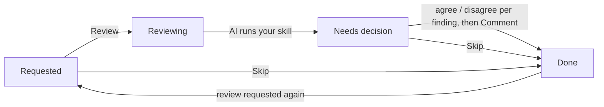
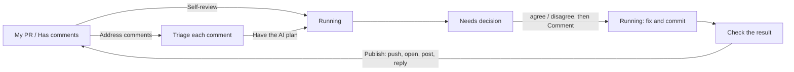

# docket-gits

docket-gits is a local web app for code review with an AI agent. It collects the GitHub pull requests waiting on you into a kanban board, lets [Claude Code](https://claude.com/claude-code) do the review, and posts to GitHub only what you agreed to, one finding at a time.

- **Review**: pull requests where your review is requested. The AI reviews; you agree or disagree with each finding before anything is posted.
- **Get reviewed**: your own open pull requests. Run a self-review, or triage the comments you received and let the AI plan and fix; you check the result before docket-gits pushes and replies.
- **Roadmap**: plan a feature as an issue / sub-issue tree in a Markdown file, then create or sync it on GitHub in one go.
- **Home**: what is left to do, decisions waiting on you, unanswered comments and AI cost, at a glance.

Everything runs on your machine. There are no dependencies to install, and state is kept in plain JSON files.

## Requirements

- Node.js 22 or later
- macOS or Linux (Windows is not supported)
- [GitHub CLI](https://cli.github.com/), logged in with `gh auth login`
- `claude` (Claude Code), logged in. AI runs use its [sandbox](https://docs.anthropic.com/en/docs/claude-code/sandboxing), which is built in on macOS and needs `bubblewrap` and `socat` on Linux; runs refuse to start without it
- `git`. AI runs work in a git worktree of the pull request; tests that need a database or other service use the one you already run on `localhost` (turn on **Let AI runs use local ports** in Claude settings for that)

## Getting started

1. Clone the repository and start the server:

   ```bash
   git clone https://github.com/ruridev/docket-gits.git
   cd docket-gits
   npm start
   ```

   There are no dependencies, so there is no `npm install`.

2. Open http://localhost:4649 and create your account (see [Signing in](#signing-in)).
3. Read the notice about the risks and agree to it. Nothing that starts `claude` works until you do.
4. Open **Settings** from the account menu at the top right, then under **Agent settings**:
   - **Work targets**: set the working directory where your skills live, and the repositories to watch (`owner/name`, one per line). Runs refuse to start until a working directory is set, and never run in your home directory or `/`.
   - **Claude settings**: pick a review skill per repository, or use the built-in review prompt. You can also choose whether AI runs may use local ports (for test databases) and which hosts they may reach to install dependencies; see [How AI runs are contained](#how-ai-runs-are-contained).
5. Press **Refresh** in the left sidebar. Review requests show up under **Requested**.

| Environment variable | Default | |
| --- | --- | --- |
| `PORT` | `4649` | Port to listen on |
| `DOCKET_DATA` | `./data` | Where settings, state and logs are stored (created with mode 0700) |
| `DOCKET_HOME` | `~/.docket-gits` | docket-gits' clones of your repositories, the worktree of each pull request, and the package cache of AI runs |
| `DOCKET_FRAME_ANCESTORS` | `'self' http://localhost:4600 http://127.0.0.1:4600` | Pages allowed to embed docket-gits in a frame (`Content-Security-Policy: frame-ancestors`); the default is the docket portal. Set `"'self'"` if you don't use docket |

If you start the server without a login shell (from launchd, for example), `gh` and `claude` may not be on `PATH` (`spawn claude ENOENT`). Add the directories that `which gh claude` prints to `PATH`.

## How AI runs are contained

AI runs read pull requests that anyone can write, so they are kept from doing anything you haven't checked:

- **The pull request's own Claude settings are not loaded.** Runs start Claude with your user settings only (`--setting-sources user`), so a `.claude/settings.json`, hook, skill or plugin committed in the pull request can't run commands outside the sandbox or widen it.
- **Each pull request gets a git worktree.** docket-gits keeps a clone of each repository under `~/.docket-gits/repos` (borrowing the objects of your own clone under the working directory, if it finds one, so it is quick) and makes a worktree per pull request under `~/.docket-gits/worktrees`, on a branch `docket/pr-<number>`. Each run starts it at the pull request head. Untracked files such as installed dependencies stay, so they are installed once per pull request. The worktree is removed when the pull request leaves the board. Your own clones are never written to.
- **Runs read GitHub only through docket-gits.** `gh` in a run sends every request to docket-gits, which lets reads through with your `gh` login and refuses anything that writes (any method but `GET`, and GraphQL mutations). Runs hold no token, and need none set up.
- **Runs can't publish.** Posting reviews, pushing, replying and creating issues or pull requests are done by docket-gits itself with your `gh` login, after you check them on the board.
- **Runs work in Claude Code's sandbox.** They can't read credentials, reach the internet (unless you turn on the browser for Playwright, which runs outside the sandbox), or write outside their worktree and the package cache. By default they may reach the common package registries to install dependencies, and not local ports; turn those on if your tests need a database or other service you run as usual. Both can be changed under **Settings → Agent settings → Claude settings**. A host that fetches URLs for you is a way out to any host: the Go module proxy (`proxy.golang.org`) is not allowed by default for that reason, so add it only for repositories you trust. Tests that start containers themselves (for example `docker compose run`) can't run inside the sandbox: start the services first.
- **Dependencies that need your credentials are installed by a setup command.** A run can't read `~/.npmrc` or your SSH keys, so it can't install from a private registry (for example GitHub Packages). Give the repository a setup command under **Settings → Agent settings → Claude settings** (for example `pnpm install --frozen-lockfile --ignore-scripts --ignore-pnpmfile`): docket-gits runs it in the worktree before each run, outside the sandbox and with your credentials, and the run starts with the dependencies in place. If it fails, the run stops with its output. The command is yours, but the files it reads (the lockfile, `.npmrc`) come from the pull request, so use flags that run no install scripts and set it only for repositories you trust.

`npm run check:sandbox` checks all this with one short real run.

## Signing in

The first time you open docket-gits, it asks you to create an account: a name and a password of 8 characters or more. There is one account and no email, because nothing is ever sent out and the account only guards this app on this PC. From then on every API call needs the signed-in session.

- Creating the account needs a setup code. While there is no account, the server prints a link with the code when it starts (`Create the account: http://localhost:4649/?setup=...`), and the code is also in `data/setup-code` (readable by your user only). Opening the link fills in the code; the code is removed once the account exists.
- The account is kept in `data/auth.json` (0600): a scrypt hash of the password and the secret that signs the session cookie. A session lasts 30 days and survives restarts.
- Browsers send `localhost` cookies to every port, so the cookie alone is not a session: signing in also gives the page an API token, kept in this browser's storage for this address only and sent with every API call. Another browser or a cleared storage asks you to sign in again.
- **Sign out** ends every session of this account, in every browser.
- Forgot the password? Run `node server.js --reset-password` in this folder. It removes only the account and prints a new setup code; your data stays.
- docket, docket-gits and docket-jobs each have their own account. Inside the docket portal, each tool shows its own sign-in page the first time.

## How it works

### Review



1. **Review** runs your skill (for example `claude -p "/<skill> <args>"`) and tells it not to post, but to return its findings as JSON.
2. You decide on each finding:
   - **Agree**: it is posted. A reason you add is reflected in the text.
   - **Disagree with a reason**: your reason is posted as your own opinion, marked with `🙅💭`.
   - **Disagree without a reason**: nothing is posted.
3. **Comment** has a new AI session with no tools write the text from the findings and your decisions only (it never sees the pull request), and docket-gits posts it as one review with your `gh` login.

The board lists open pull requests matching `user-review-requested:@me` (requests to a team are not included). It fetches every 5 minutes by default while the page is open (you can limit it to certain hours in **Settings → Refresh**) (and right away when you come back to it), and the **Refresh** button fetches at any time. Each fetch lists the pull requests first and reads full details only for those updated since the last fetch. A pull request comes back to **Requested** when a review is requested again, or when the author has answered all of your comments.

You can drag cards between lanes. Dragging to **Done** skips the pull request, and dragging from **Done** to **Reviewing** reviews it again.

On both boards, **+** in the sidebar adds filters: repository, author, approved, merged, labels and milestone. Each tab keeps its own filters in this browser.

### Get reviewed



- **Self-review** runs your self-review skill. Findings you agree with are fixed; after you check the result, they are posted, the fixes pushed, and each one answered with the commit SHA.
- **Address comments** first lists the unanswered comments *without* the AI, so you form your own view before reading the AI's. For each one you agree, disagree (with a reason) or skip.
- **Have the AI plan** returns a plan per comment without changing anything: fix, reply, defer, split into another pull request, create a follow-up issue, or rebut (when the AI thinks your disagreement is wrong).
- You review the plans, then **Comment** has the AI carry them out in the pull request's worktree: it fixes, runs the tests and commits, and writes the replies, issues and split pull requests. It can't publish anything itself.
- **Check and publish** shows what it made: the commits with their diff, the replies, the issues and the Draft pull requests. Changes to CI or repository settings (`.github/`, `.gitattributes`, ...) and executable files are flagged and need an extra confirmation, since they run with the repository's secrets once pushed. **Publish** pushes exactly those commits (never forced; it stops if the branch moved since the run), then creates the issues and pull requests and posts the replies with your `gh` login. If something fails, publishing again does only the rest.

A comment counts as unanswered while you are not the last one to have written in its thread. Fix runs on your own pull requests go one at a time per repository.

### Roadmap

A plan is one Markdown file. Heading depth is the issue tree, the text under a heading is the issue description, and attributes go in `{...}` at the end of the heading:

```markdown
# Notification settings screen {issue=#314 start=2026-11-05 end=2026-11-13 @alice labels=backend,ui sprint="Sprint 12"}

Description

## API {start=2026-11-05 end=2026-11-07}

## Docs {issue=#41 repo=acme/docs}
```

- The first time you open a GitHub Project, choose which of its Date fields hold the start and end dates, and which Iteration field holds the plan's iteration (`sprint=` in the Markdown). Nothing is guessed from field names, and **Field settings** changes the choice later. A field left as **Not used** stays in the plan only.
- A Project without Date fields can still be planned. Add Date fields to it later and choose them in **Field settings**: the plan's dates then show as changes, and the next **Push changes** writes them to GitHub.
- Filters also offer the Project's own fields: text (contains), number and date (range), single select and iteration.
- Edit plans on a timeline: drag bars to move them or change their dates, add sub-issues, or import existing issues by URL.
- **Apply to GitHub** creates the issues (parents first), links sub-issues and can add them to a GitHub Project with dates and iteration. **Push changes** updates them later.
- Changes made on GitHub are pulled back in. A field changed on both sides is shown as a conflict for you to resolve, and pushing stops instead of overwriting newer changes on GitHub.
- Plans are stored under `~/docket-plans` by default, one folder per GitHub Project, in a git repository so you can see what changed.

## Configuration

All settings are in **Settings**, from the account menu at the top right. They are saved when you press **Save**, and can be exported to and imported from `docket-settings.json`.

- **Execution & logs**: how many runs at once (2), how long to keep logs (30 days).
- **Work targets**: working directory, repositories (each can have its own working directory), pull request authors to show, how long merged and done pull requests stay on the board.
- **Shared prompts**: the built-in review and address-comments prompts, for repositories without a skill of their own.
- **Claude settings**: model, effort, and the skills per repository for review, self-review and addressing comments.
- **Roadmap**: GitHub Projects, iterations and periods to list, plan folder.
- **Refresh**: how often the screen and GitHub are refreshed, and during which hours.
- **Language**: display language (English / 日本語 / 한국어), the language the AI writes in, a language per pull request author, and the agree / disagree marks.
- **Theme** and **Terms** (lane names).

Skill arguments can use `{pr-number}`, `{pr-url}`, `{repo-name}`, `{owner-name}` and `{full-repo-name}`, for example `{pr-number} --repo {repo-name}`.

### Claude

- Skills are read from `.claude/skills` in the working directories and your home directory.
- Every run works in the pull request's worktree (see [How AI runs are contained](#how-ai-runs-are-contained)), with your working directory added read-only so its other repositories can be read. Its skills are passed to the run as a plugin (still invoked as `/<skill>`); the settings, hooks, skills and plugins in the pull request's own `.claude/` are not loaded (its `CLAUDE.md` still is, as text like the rest of the code). Bash commands run in Claude Code's sandbox and need no allow list; `allowed-tools` in a skill is not needed for docket-gits (it still applies when you use the skill yourself).
- Steps of a skill that write outside the worktree (for example `git fetch` or `git worktree add` in a clone under your working directory) fail. The worktree is already at the pull request head, with the base branch fetched (`origin/<base>`), so skills can work in the current directory.
- Steps that publish (posting, pushing, replying, opening pull requests, creating issues) fail too, since `gh` in a run can only read. docket-gits tells fix runs to hand those back instead, and publishes them after you check them.

### Several GitHub accounts

docket-gits uses whichever account is active in `gh`: it fetches, posts and pushes as that account (pushes go over HTTPS with `gh`'s credentials), and AI runs read GitHub as that account through docket-gits. To switch, make sure nothing is running, run `gh auth switch`, then press **Refresh**.

`data/` is not split per account. To keep accounts apart, run a second instance:

```bash
DOCKET_DATA=~/docket-data-other PORT=4650 node server.js
```

## Security

docket-gits runs an AI agent on pull requests that anyone can write, so it assumes the agent can be steered by them (prompt injection) and limits what the agent can reach instead of what it is told:

- **The agent can't write to GitHub.** Its `gh` reaches GitHub only through docket-gits, which lets reads through with your `gh` login and refuses every write; the agent holds no token. Posting, pushing, replying and creating issues or pull requests are done by docket-gits itself, after you approve them on the board.
- **The agent runs in a sandbox.** Its Bash commands run in [Claude Code's sandbox](https://docs.anthropic.com/en/docs/claude-code/sandboxing): it can't read credential stores (`~/.ssh`, `~/.config/gh`, the macOS keychain, `~/.aws`, `~/.netrc`, `~/.npmrc`, ...), `data/`, or the data of docket and docket-jobs in their default places (so a run can't use their sign-in to reach them on local ports), it can reach no host but the package registries you allow and, if allowed, local ports, and it can write only to its worktree, to what a commit needs in docket-gits' clone, and to the package cache. It can't change that clone's git config or hooks, or any branch outside `docket/`. Runs refuse to start if the sandbox is unavailable. Claude's own tools follow the same rules: reading those paths and editing your working directory are denied, web fetch and search are off, and your MCP servers are not loaded. Only an allow list of environment variables reaches a run, so tokens in the server's environment don't (`AWS_*` and `GOOGLE_*` only when Claude itself uses Bedrock or Vertex). The pull request's `.claude/` settings, hooks and plugins are not loaded. `npm run check:sandbox` checks all this with a real run.
- **What is pushed is what you checked.** docket-gits reads the run's commits from its clone, checks that they build on the pull request head, shows them, and pushes exactly those commits from that clone without force. Agent runs never run git hooks (`core.hooksPath` is `/dev/null`).
- **Check before you publish.** The agent's commits are code you push to your repository: read the diff. Changes to CI or repository settings and executable files are flagged and need an extra confirmation, because they run with the repository's secrets once pushed. Protect your default branches.
- **Comments that anyone can write are read only by runs that change nothing** (review, self-review, fix plan). A fix run starts a new session that gets only the plan you approved (or, with **Follow PR comments**, your own last comment, which docket-gits fetches by your login) and the code. The plan was written by an AI that read the comments, so read it before you approve it. A post is written by a run with no tools that sees only the findings and your decisions.
- **What a run can still do:** read what your `gh` login can read on GitHub and the files your user can read outside the denied paths (for example other repositories in your working directory, shell history, or other tools' settings in your home directory; if you keep docket or docket-jobs data somewhere else, deny it with `DOCKET_PORTAL_DATA` / `DOCKET_JOBS_DATA_DIR` in docket-gits' environment), reach the local ports and package registries you allow (a local service without authentication would be reachable), and put what it read into the text it hands back. Only configure repositories you trust, and read findings, replies and diffs before you publish them.
- **Give AI runs a browser for Playwright** (off by default) starts Chromium outside the sandbox, so a run can read every file your user can through `file://` URLs, credentials included. Turn it on only for repositories you trust.
- **AI runs cost money.** Costs are shown per pull request and in total.
- The server listens on `127.0.0.1` only, and rejects requests from other web pages. The API needs the signed-in session (see [Signing in](#signing-in)); a program running as your user can still read `data/`, so this is no defense against malware on your account. Don't run docket-gits on a PC you share with other people.
- Fix runs may edit files under `.claude/skills` of their worktree without asking only when **Let fix runs edit .claude/skills** is on in Claude settings (off by default), so an instruction hidden in a comment can't slip into a skill unnoticed; such edits are part of the commits you check before publishing.
- Importing `docket-settings.json` never changes skill edits or local folders (working directories, plan folder). **Extra claude args** and **Read-only tools** were removed: saved values are ignored and dropped on the next save.
- `data/` (settings, state, logs, results waiting to be published) is readable only by you (0700, files 0600).
- Found a security problem? Please report it privately through [GitHub's private vulnerability reporting](https://github.com/ruridev/docket-gits/security/advisories/new), not in a public issue.

## Related

- [docket](https://github.com/ruridev/docket): one page to open, start and stop the local web tools on your PC.
- [docket-jobs](https://github.com/ruridev/docket-jobs): manage the background jobs that start with your PC.

## Development

```bash
npm test
npm run check:sandbox   # one short real Claude run: checks what runs can and can't reach
```

The whole app is `server.js`, `workspace.js` (where and how AI runs work), `github-proxy.js` (their read-only way to GitHub), `publish.js` (checking and publishing their work) and `index.html`, with no build step.

## License

[MIT](LICENSE)
