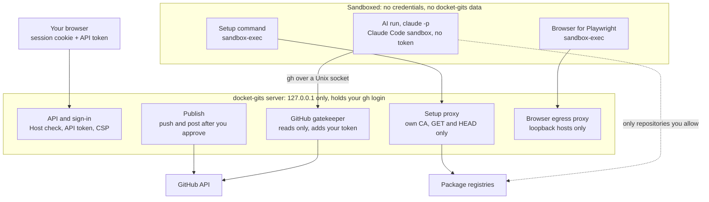

# docket-gits

docket-gits is a local web app for code review with an AI agent. It collects the GitHub pull requests waiting on you into a kanban board, lets [Claude Code](https://claude.com/claude-code) do the review, and posts to GitHub only what you agreed to, one finding at a time.

- **Review**: pull requests where your review is requested. The AI reviews; you agree or disagree with each finding before anything is posted.
- **Get reviewed**: your own open pull requests. Run a self-review, or triage the comments you received and let the AI plan and fix; you check the result before docket-gits pushes and replies.
- **Roadmap**: plan a feature as an issue / sub-issue tree in a Markdown file, then create or sync it on GitHub in one go.
- **Home**: what is left to do, decisions waiting on you, unanswered comments and AI cost, at a glance.

Everything runs on your machine. There are no dependencies to install, and state is kept in plain JSON files.

## Getting started

Needs Node.js 22+, macOS or Linux, and a logged-in [GitHub CLI](https://cli.github.com/) and [Claude Code](https://claude.com/claude-code).

```bash
git clone https://github.com/ruridev/docket-gits.git
cd docket-gits
npm start
```

Open http://localhost:4649, create your account, then set your working directory and repositories in **Settings**. Details: [docs/setup.md](docs/setup.md).

## How AI runs are contained

Anyone who can open a pull request or write a comment can put instructions in it for the AI. So only the server holds your `gh` login: AI runs work in a sandbox with no credentials, read GitHub through a proxy that refuses writes, and nothing is posted or pushed until you check it on the board.



The server listens on `127.0.0.1` only. Don't run docket-gits on a PC you share with other people. Details and remaining risks: [docs/SECURITY.md](docs/SECURITY.md).

## Documentation

- [Setup](docs/setup.md): requirements, first run, environment variables
- [Usage](docs/usage.md): signing in, the boards, settings
- [Security](docs/SECURITY.md): how AI runs are contained, and how to report a vulnerability
- [Development](docs/development.md): tests and code layout

## License

[MIT](LICENSE)
