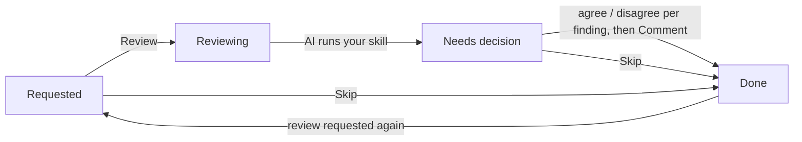
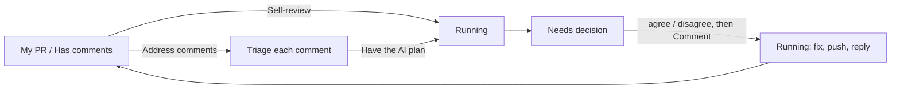

# docket-gits

docket-gits is a local web app for code review with an AI agent. It collects the GitHub pull requests waiting on you into a kanban board, lets [Claude Code](https://claude.com/claude-code) or [Codex CLI](https://developers.openai.com/codex/cli) do the review, and posts to GitHub only what you agreed to, one finding at a time.

- **Review**: pull requests where your review is requested. The AI reviews; you agree or disagree with each finding before anything is posted.
- **Get reviewed**: your own open pull requests. Run a self-review, or triage the comments you received and let the AI plan, fix, push and reply.
- **Roadmap**: plan a feature as an issue / sub-issue tree in a Markdown file, then create or sync it on GitHub in one go.
- **Home**: what is left to do, decisions waiting on you, unanswered comments and AI cost, at a glance.

Everything runs on your machine. There are no dependencies to install, and state is kept in plain JSON files.

## Requirements

- Node.js 22 or later
- macOS or Linux (Windows is not supported)
- [GitHub CLI](https://cli.github.com/), logged in with `gh auth login`
- `claude` (Claude Code) or `codex` (Codex CLI), logged in

## Getting started

1. Clone the repository and start the server:

   ```bash
   git clone https://github.com/ruridev/docket-gits.git
   cd docket-gits
   node server.js
   ```

2. Open http://localhost:4649 and create your account (see [Signing in](#signing-in)).
3. Read the notice about the risks and agree to it. Nothing that starts `claude` or `codex` works until you do.
4. Open **Settings** from the account menu at the top right, then under **Agent settings**:
   - **Work targets**: set the working directory where your skills live, and the repositories to watch (`owner/name`, one per line). Runs refuse to start until a working directory is set, and never run in your home directory or `/`.
   - **Claude settings** / **Codex settings**: pick a review skill per repository, or use the built-in review prompt.
5. Press **Refresh** in the left sidebar. Review requests show up under **Requested**.

| Environment variable | Default | |
| --- | --- | --- |
| `PORT` | `4649` | Port to listen on |
| `DOCKET_DATA` | `./data` | Where settings, state and logs are stored (created with mode 0700) |
| `DOCKET_FRAME_ANCESTORS` | `'self' http://localhost:4600 http://127.0.0.1:4600` | Pages allowed to embed docket-gits in a frame (`Content-Security-Policy: frame-ancestors`) |

If you start the server without a login shell (from launchd, for example), `gh` and `claude` may not be on `PATH` (`spawn claude ENOENT`). Add the directories that `which gh claude` prints to `PATH`.

## Signing in

The first time you open docket-gits, it asks you to create an account: a name and a password of 8 characters or more. There is one account and no email, because nothing is ever sent out and the account only guards this app on this PC. From then on every API call needs the signed-in session.

- The account is kept in `data/auth.json` (0600): a scrypt hash of the password and the secret that signs the session cookie. A session lasts 30 days and survives restarts.
- Forgot the password? Run `node server.js --reset-password` in this folder. It removes only the account; your data stays, and the next visit asks you to create the account again.
- Create the account right after the first start: until then, any program on this PC that can reach the port could create it first.
- docket, docket-gits and docket-jobs each have their own account. Inside the docket portal, each tool shows its own sign-in page the first time.

## How it works

### Review



1. **Review** runs your skill (for example `claude -p "/<skill> <args>"`) and tells it not to post, but to return its findings as JSON.
2. You decide on each finding:
   - **Agree**: it is posted. A reason you add is reflected in the text.
   - **Disagree with a reason**: your reason is posted as your own opinion, marked with `🙅💭`.
   - **Disagree without a reason**: nothing is posted.
3. **Comment** starts a new AI session that sees only the findings and your decisions, not the pull request, and posts them as one review. That session may run only `gh api` on the reviews of that pull request (Claude); Codex runs it with your `codexArgs`.

The board lists open pull requests matching `user-review-requested:@me` (requests to a team are not included). It fetches every 5 minutes between 9:00 and 19:00 by default while the page is open (and right away when you come back to it), and the **Refresh** button fetches at any time. Each fetch lists the pull requests first and reads full details only for those updated since the last fetch. A pull request comes back to **Requested** when a review is requested again, or when the author has answered all of your comments.

You can drag cards between lanes. Dragging to **Done** skips the pull request, and dragging from **Done** to **Reviewing** reviews it again.

On both boards, **+** in the sidebar adds filters: repository, author, approved, merged, labels, milestone and assignees. Each tab keeps its own filters in this browser.

### Get reviewed



- **Self-review** runs your self-review skill. Findings you agree with are posted, fixed, pushed and answered with the commit SHA.
- **Address comments** first lists the unanswered comments *without* the AI, so you form your own view before reading the AI's. For each one you agree, disagree (with a reason) or skip.
- **Have the AI plan** returns a plan per comment without changing anything: fix, reply, defer, split into another pull request, create a follow-up issue, or rebut (when the AI thinks your disagreement is wrong).
- You review the plans, then **Comment** carries them out: fix, push and reply.

A comment counts as unanswered while you are not the last one to have written in its thread. Runs on your own pull requests go one at a time per repository, since they switch branches in the same clone.

### Roadmap

A plan is one Markdown file. Heading depth is the issue tree, the text under a heading is the issue description, and attributes go in `{...}` at the end of the heading:

```markdown
# Notification settings screen {issue=#314 start=2026-11-05 end=2026-11-13 @alice labels=backend,ui sprint="Sprint 12"}

Description

## API {start=2026-11-05 end=2026-11-07}

## Docs {issue=#41 repo=acme/docs}
```

- The first time you open a GitHub Project, choose which of its Date fields hold the start and end dates, and which Iteration field holds the plan's iteration (`sprint=` in the Markdown). Nothing is guessed from field names, and **Field settings** changes the choice later. A field left as **Not used** stays in the plan only.
- A Project without Date fields can still be planned. Add Date fields to it later and choose them in **Field settings**: the plan's dates then show as changes, and the next **Push changes** writes them to GitHub.
- Filters also offer the Project's own fields: text (contains), number and date (range), single select and iteration.
- Edit plans on a timeline: drag bars to move them or change their dates, add sub-issues, or import existing issues by URL.
- **Apply to GitHub** creates the issues (parents first), links sub-issues and can add them to a GitHub Project with dates and iteration. **Push changes** updates them later.
- Changes made on GitHub are pulled back in. A field changed on both sides is shown as a conflict for you to resolve, and pushing stops instead of overwriting newer changes on GitHub.
- Plans are stored under `~/docket-plans` by default, one folder per GitHub Project, in a git repository so you can see what changed.

## Configuration

All settings are in **Settings**, from the account menu at the top right. They are saved when you press **Save**, and can be exported to and imported from `docket-settings.json`.

- **Execution & logs**: default AI tool, how many runs at once (2), how long to keep logs (30 days).
- **Work targets**: working directory, repositories (each can have its own working directory), pull request authors to show, how long merged and done pull requests stay on the board.
- **Shared prompts**: the built-in review and address-comments prompts, for repositories without a skill of their own.
- **Claude settings** / **Codex settings**: model, effort, extra arguments, and the skills per repository for review, self-review and addressing comments.
- **Roadmap**: GitHub Projects, iterations and periods to list, plan folder.
- **Refresh**: how often the screen and GitHub are refreshed, and during which hours.
- **Language**: display language (English / 日本語 / 한국어), the language the AI writes in, a language per pull request author, and the agree / disagree marks.
- **Theme** and **Terms** (lane names).

Skill arguments can use `{pr-number}`, `{pr-url}`, `{repo-name}`, `{owner-name}` and `{full-repo-name}`, for example `{pr-number} --repo {repo-name}`.

### Claude or Codex

Pick the default tool under **Execution & logs**. The arrow next to each button runs the other tool once. A card keeps the tool it started with until it is done.

- Claude skills are read from `.claude/skills`, Codex skills from `.agents/skills` and `.codex/skills`. Each tool has its own skill settings, and a tool that is not set up is disabled.
- For Claude, list the commands your skill needs in `--allowedTools` under **Extra claude args**.
- Review, self-review and **Have the AI plan** are meant to change nothing. For these Claude runs, `--permission-mode` and `--allowedTools` are removed from the extra args and only **Read-only tools** (`readOnlyTools`) are allowed. Write / Edit and `gh api` with a write flag (`-X`, `--method`, `-f`, `-F`, `--field`, `--raw-field`, `--input`) are denied. Empty `readOnlyTools` uses the extra args as they are. Codex runs them with `--sandbox read-only`.
- Posting a review starts a new session: `--permission-mode` and `--allowedTools` are removed, and only `gh api` on that pull request's reviews is allowed. Applying fixes uses the full args.
- Every Claude run denies reading credentials (`~/.ssh`, `~/.aws`, `~/.config/gh`, `~/.netrc`, `.env*` files and this app's `data/`), `gh api --hostname`, force-push, `gh pr merge`, `gh repo delete` / `edit`, `gh secret`, `gh variable` and `gh gist`.
- Every Claude run denies `gh auth`, `gh alias`, `gh extension`, `gh config`, `git config`, `git credential`, `git -c` and reading `~/.ssh`, `~/.aws`, `~/.config/gh` and `~/.netrc`, on top of your own `--disallowedTools`.
- Codex runs with `codex exec --json`, by default with `--approve-for-me` and no network access. Its output has no price, so its cost is shown as unavailable.

### Several GitHub accounts

docket-gits uses whichever account is active in `gh`, and the AI posts and pushes as that account. To switch, make sure nothing is running, run `gh auth switch`, then press **Refresh**. If your clones use SSH remotes, `git push` uses your SSH key, so switch that too.

`data/` is not split per account. To keep accounts apart, run a second instance:

```bash
DOCKET_DATA=~/docket-data-other PORT=4650 node server.js
```

## Security

docket-gits runs an AI agent that can execute commands without asking you each time. Before you use it:

- **Only configure repositories you trust.** The content of a pull request goes to the AI as it is, so a malicious pull request can try to steer it (prompt injection).
- **Posts and pushes cannot be undone.** **Comment** asks you to confirm before it runs.
- **AI runs cost money.** Costs are shown per pull request and in total.
- The server listens on `127.0.0.1` only, and rejects requests from other web pages. The API needs the signed-in session (see [Signing in](#signing-in)); a program running as your user can still read `data/`, so this is no defense against malware on your account. Don't run docket-gits on a PC you share with other people.
- Reviews and plans run with read-only tools (`readOnlyTools`). **Comment** starts a new session that never reads the pull request and, with Claude, may only call `gh api` on that pull request's reviews. No run starts in your home directory or `/`. These limits match the command Claude writes, not the same program run another way (for example through `sh -c`), so they reduce what an injected instruction can do but are not a sandbox.
- Only fix runs may edit files under `<working directory>/.claude/skills` without asking; other protected paths are denied, and review and post runs can't edit skills.
- Importing `docket-settings.json` never changes agent args, `readOnlyTools` or local folders (working directories, plan folder).
- `data/` is readable only by you (0700, files 0600).

## Related

- [docket](https://github.com/ruridev/docket): one page to open, start and stop the local web tools on your PC.
- [docket-jobs](https://github.com/ruridev/docket-jobs): manage the background jobs that start with your PC.

## Development

```bash
node --test
```

The whole app is `server.js` and `index.html`, with no build step.

## License

[MIT](LICENSE)
