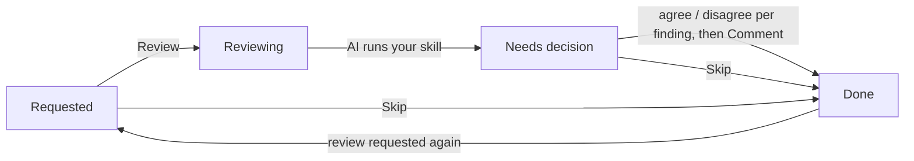
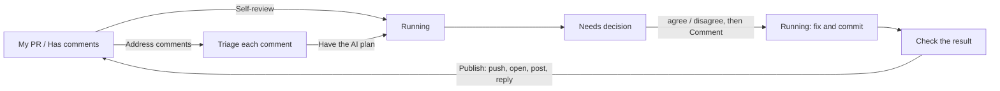

# Using docket-gits

How to sign in, review pull requests, handle the reviews you get, plan a roadmap, and configure docket-gits. For setup, see [Setup](setup.md).

## Signing in

The first time you open docket-gits, it asks you to create an account: a name and a password of 8 characters or more. There is one account and no email, because nothing is ever sent out and the account only guards this app on this PC. From then on every API call needs the signed-in session.

- Creating the account needs a setup code. While there is no account, the server prints a link with the code when it starts (`Create the account: http://localhost:4649/?setup=...`), and the code is also in `data/setup-code` (readable by your user only). Opening the link fills in the code; the code is removed once the account exists.
- The account is kept in `data/auth.json` (0600): a scrypt hash of the password and the secret that signs the session cookie. A session lasts 30 days and survives restarts.
- Browsers send `localhost` cookies to every port, so the cookie alone is not a session: signing in also gives the page an API token, kept in this browser's storage for this address only and sent with every API call. Another browser or a cleared storage asks you to sign in again.
- **Sign out** ends every session of this account, in every browser.
- Forgot the password? Run `node server.js --reset-password` in this folder. It removes only the account and prints a new setup code; your data stays.

## How it works

AI runs cost money. Costs are shown per pull request and in total.

### Review



1. **Review** runs your skill (for example `claude -p "/<skill> <args>"`) and tells it not to post, but to return its findings as JSON.
2. You decide on each finding:
   - **Agree**: it is posted. A reason you add is reflected in the text.
   - **Disagree with a reason**: your reason is posted as your own opinion, marked with `🙅💭`.
   - **Disagree without a reason**: nothing is posted.
3. **Comment** has a new AI session with no tools write the text from the findings and your decisions only (it never sees the pull request), and docket-gits posts it as one review with your `gh` login.

The board lists open pull requests matching `user-review-requested:@me` (requests to a team are not included). It fetches every 5 minutes by default while the page is open (you can limit it to certain hours in **Settings → Refresh**) (and right away when you come back to it), and the **Refresh** button fetches at any time. Each fetch lists the pull requests first and reads full details only for those updated since the last fetch. A pull request comes back to **Requested** when a review is requested again, or when the author has answered all of your comments.

You can drag cards between lanes. Dragging to **Done** skips the pull request, and dragging from **Done** to **Reviewing** reviews it again.

On both boards, **+** in the sidebar adds filters: repository, author, approved, merged, labels and milestone. Each tab keeps its own filters in this browser.

### Get reviewed



- **Self-review** runs your self-review skill. Findings you agree with are fixed; after you check the result, they are posted, the fixes pushed, and each one answered with the commit SHA.
- **Address comments** first lists the unanswered comments *without* the AI, so you form your own view before reading the AI's. For each one you agree, disagree (with a reason) or skip.
- **Have the AI plan** returns a plan per comment without changing anything: fix, reply, defer, split into another pull request, create a follow-up issue, or rebut (when the AI thinks your disagreement is wrong).
- You review the plans, then **Comment** has the AI carry them out in the pull request's worktree: it fixes, runs the tests and commits, and writes the replies, issues and split pull requests. It can't publish anything itself.
- **Check and publish** shows what it made: the commits with their diff, the replies, the issues and the Draft pull requests. Changes to CI or repository settings (`.github/`, `.gitattributes`, ...) and executable files are flagged and need an extra confirmation, since they run with the repository's secrets once pushed. **Publish** pushes exactly those commits (never forced; it stops if the branch moved since the run), then creates the issues and pull requests and posts the replies with your `gh` login. If something fails, publishing again does only the rest.

A comment counts as unanswered while you are not the last one to have written in its thread. Fix runs on your own pull requests go one at a time per repository.

### Roadmap

A plan is one Markdown file. Heading depth is the issue tree, the text under a heading is the issue description, and attributes go in `{...}` at the end of the heading:

```markdown
# Notification settings screen {issue=#314 start=2026-11-05 end=2026-11-13 @alice labels=backend,ui sprint="Sprint 12"}

Description

## API {start=2026-11-05 end=2026-11-07}

## Docs {issue=#41 repo=acme/docs}
```

- The first time you open a GitHub Project, choose which of its Date fields hold the start and end dates, and which Iteration field holds the plan's iteration (`sprint=` in the Markdown). Nothing is guessed from field names, and **Field settings** changes the choice later. A field left as **Not used** stays in the plan only.
- A Project without Date fields can still be planned. Add Date fields to it later and choose them in **Field settings**: the plan's dates then show as changes, and the next **Push changes** writes them to GitHub.
- Filters also offer the Project's own fields: text (contains), number and date (range), single select and iteration.
- Edit plans on a timeline: drag bars to move them or change their dates, add sub-issues, or import existing issues by URL.
- **Apply to GitHub** creates the issues (parents first), links sub-issues and can add them to a GitHub Project with dates and iteration. **Push changes** updates them later.
- Changes made on GitHub are pulled back in. A field changed on both sides is shown as a conflict for you to resolve, and pushing stops instead of overwriting newer changes on GitHub.
- Plans are stored under `~/docket-plans` by default, one folder per GitHub Project, in a git repository so you can see what changed.

## Configuration

All settings are in **Settings**, from the account menu at the top right. They are saved when you press **Save**, and can be exported to and imported from `docket-settings.json`.

- **Execution & logs**: how many runs at once (2), how long to keep logs (30 days).
- **Work targets**: working directory, repositories (each can have its own working directory), pull request authors to show, how long merged and done pull requests stay on the board.
- **Shared prompts**: the built-in review and address-comments prompts, for repositories without a skill of their own.
- **Claude settings**: model, effort, and the skills per repository for review, self-review and addressing comments.
- **Roadmap**: GitHub Projects, iterations and periods to list, plan folder.
- **Refresh**: how often the screen and GitHub are refreshed, and during which hours.
- **Language**: display language (English / 日本語 / 한국어), the language the AI writes in, a language per pull request author, and the agree / disagree marks.
- **Theme** and **Terms** (lane names).

Skill arguments can use `{pr-number}`, `{pr-url}`, `{repo-name}`, `{owner-name}` and `{full-repo-name}`, for example `{pr-number} --repo {repo-name}`.

### Claude

- Skills are read from `.claude/skills` in the working directories and your home directory.
- Every run works in the pull request's worktree (see [SECURITY.md](SECURITY.md#claude-settings-and-worktrees)), with your working directory added read-only so its other repositories can be read. Its skills are passed to the run as a plugin (still invoked as `/<skill>`); the settings, hooks, skills and plugins in the pull request's own `.claude/` are not loaded (its `CLAUDE.md` still is, as text like the rest of the code). Bash commands run in Claude Code's sandbox and need no allow list; `allowed-tools` in a skill is not needed for docket-gits (it still applies when you use the skill yourself).
- Steps of a skill that write outside the worktree (for example `git fetch` or `git worktree add` in a clone under your working directory) fail. The worktree is already at the pull request head, with the base branch fetched (`origin/<base>`), so skills can work in the current directory.
- Steps that publish (posting, pushing, replying, opening pull requests, creating issues) fail too, since `gh` in a run can only read. docket-gits tells fix runs to hand those back instead, and publishes them after you check them.

### Several GitHub accounts

docket-gits uses whichever account is active in `gh`: it fetches, posts and pushes as that account (pushes go over HTTPS with `gh`'s credentials), and AI runs read GitHub as that account through docket-gits. To switch, make sure nothing is running, run `gh auth switch`, then press **Refresh**.

`data/` is not split per account. To keep accounts apart, run a second instance:

```bash
DOCKET_DATA=~/docket-data-other PORT=4650 node server.js
```
